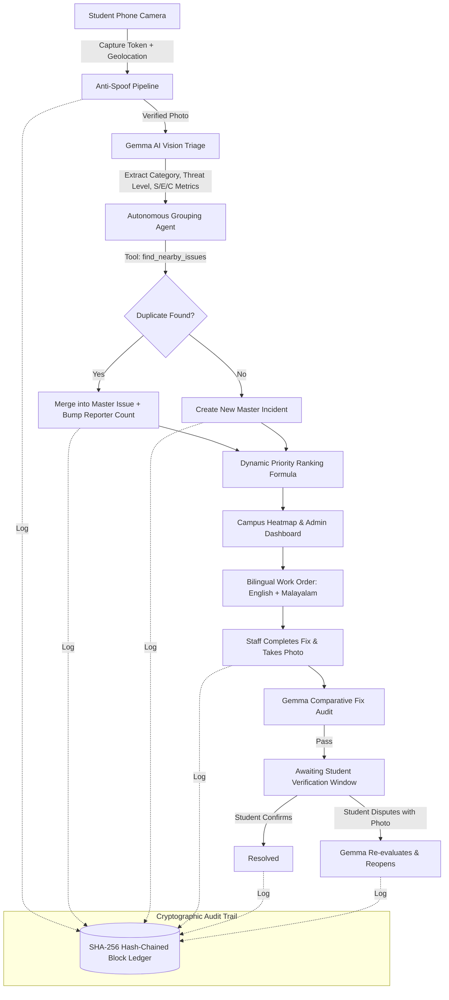

# ⚡ CUSAT-Pulse

> **AI-Powered Civic Issue Tracker & Cryptographically Audited Maintenance Platform for Campus Infrastructure**  
> *Built with Google Gemma / Gemini Multimodal AI, Autonomous Tool-Calling Agents, React Leaflet, and a Tamper-Proof Cryptographic Ledger.*

---

## 📌 Table of Contents

- [Overview: What is CUSAT-Pulse?](#-overview-what-is-cusat-pulse)
- [The Problem vs. The Solution](#-the-problem-vs-the-solution)
- [How It Works: Core Architecture & Engines](#-how-it-works-core-architecture--engines)
  - [1. Multimodal Vision Screening & Anti-Spoofing](#1-multimodal-vision-screening--anti-spoofing)
  - [2. Autonomous Tool-Calling Grouping Agent](#2-autonomous-tool-calling-grouping-agent)
  - [3. Dynamic Mathematical Priority Ranking](#3-dynamic-mathematical-priority-ranking)
  - [4. Cryptographic Hash-Chained Audit Ledger](#4-cryptographic-hash-chained-audit-ledger)
  - [5. Closed-Loop Fix Auditing & Student Dispute Window](#5-closed-loop-fix-auditing--student-dispute-window)
  - [6. Bilingual Work Order Generation (English & Malayalam)](#6-bilingual-work-order-generation-english--malayalam)
  - [7. Student Integrity Rating & Trust System](#7-student-integrity-rating--trust-system)
- [User Walkthrough: How to Use It](#-user-walkthrough-how-to-use-it)
  - [For Students](#for-students)
  - [For Staff & Administrators](#for-staff--administrators)
- [Quick Start & Setup Guide](#-quick-start--setup-guide)
  - [Prerequisites](#prerequisites)
  - [Option A: One-Click Launch (Windows)](#option-a-one-click-launch-windows)
  - [Option B: Manual Setup (Step-by-Step)](#option-b-manual-setup-step-by-step)
  - [Mobile Phone Testing via Cloudflare Tunnel](#mobile-phone-testing-via-cloudflare-tunnel)
  - [Demo Login Accounts](#demo-login-accounts)
- [Environment Configuration (`.env`)](#-environment-configuration-env)
- [Demo Scripts & Inspection Tools](#-demo-scripts--inspection-tools)
- [Project Directory Structure](#-project-directory-structure)
- [Testing & Quality Assurance](#-testing--quality-assurance)
- [License](#-license)

---

## 🌟 Overview: What is CUSAT-Pulse?

**CUSAT-Pulse** is a next-generation campus civic maintenance and hazard tracking system built specifically for the **Cochin University of Science and Technology (CUSAT)** campus.

Rather than treating campus repair requests as plain text tickets dumped into an unmanaged inbox, CUSAT-Pulse turns every smartphone on campus into a verified maintenance sensor. When students spot a burst pipe, hazardous electrical wiring, broken lighting, or damaged infrastructure, they photograph it directly inside the app. 

A multimodal AI engine powered by **Google Gemma / Gemini** continuously triages incoming submissions, verifies authenticity, detects duplicate reports using an autonomous tool-calling agent, groups related campus incidents, generates actionable bilingual work orders for local tradesmen, and verifies repair photographs. Every single state change is recorded in an immutable, cryptographic hash-chained ledger to ensure administrative transparency.

---

## 🎯 The Problem vs. The Solution

| Campus Maintenance Bottleneck | Traditional Issue Trackers | How CUSAT-Pulse Solves It |
|---|---|---|
| **Duplicate Ticket Storms** | 20 students report the same water leak in a hostel; staff receive 20 separate tickets and struggle to triage. | An **autonomous Gemma agent** queries nearby open issues, compares photos, merges duplicates into a single master incident, and boosts priority based on reporter count. |
| **Fake or Staged Reports** | Internet memes, downloaded stock photos, or old screenshots are uploaded as prank complaints. | **In-app camera HUD** with anti-spoof scanline, moiré screen detection, perceptual hashing, and capture tokens blocks screen re-photography. |
| **Premature Ticket Closure** | Staff mark tickets as "Resolved" without actually finishing the repair; students have no recourse. | **Closed-loop verification**: Staff must submit a photo of the completed repair. Gemma compares before-and-after photos. If passed, students get a countdown window to confirm or dispute. |
| **Data Tampering & Lack of Audit** | Admins or contractors can quietly delete complaints, downgrade hazards, or modify logs to avoid accountability. | Every single event is permanently recorded in a **SHA-256 hash-chained ledger**. Any database alteration breaks the chain and is flagged instantly. |
| **Language Barriers for Campus Staff** | Technical English tickets often create miscommunication with campus trade technicians (electricians, plumbers). | Automatically outputs bilingual work orders in both **English and Malayalam** (`മലയാളം`) with specific safety equipment notes and tools needed. |

---

## ⚙️ How It Works: Core Architecture & Engines



### 1. Multimodal Vision Screening & Anti-Spoofing
- **In-App Live Camera Capture**: Bypasses device gallery pickers to prevent uploading unverified photos. Captures an ephemeral `capture_token` alongside camera orientation and device GPS metadata.
- **Screen & Moiré Detection**: Inspects images for LCD pixel grids, moiré patterns, bezel edges, or laptop screens. Re-photographed images are automatically flagged with `gps_flag` warnings.
- **Perceptual Image Hashing (pHash)**: Compares incoming photos against existing records to detect exact-duplicate photos submitted from other devices.
- **AI Triage**: Google Gemma / Gemini models screen the image, extract a human-readable title, classify the issue category (`Electrical`, `Plumbing`, `Structural`, `Sanitation`, `Network/IT`, etc.), assign a threat tier (`Low`, `Medium`, `High`, `Critical`), and evaluate numerical scores for Severity, Emergency, and Complexity.

### 2. Autonomous Tool-Calling Grouping Agent
When a report passes visual triage, Gemma acts as an autonomous agent equipped with specialized tools:
- `find_nearby_issues(lat, lng, radius_meters=50)`: Scans for existing open incidents within physical campus proximity.
- `get_issue_photos(issue_id)`: Fetches past photos of nearby incidents for visual comparison.
- `merge_into_issue(issue_id, merge_type)`: Merges the new report into the active master ticket, crediting the student without creating duplicate work.
- `create_issue(title, category, threat_level, ...)`: Spawns a brand-new master incident when no duplicates exist.
- `link_related(issue_a, issue_b, reason)`: Identifies correlated infrastructure failures (e.g., water shortage in Sahara Hostel linked to a burst pump at the Amenity Centre).

### 3. Dynamic Mathematical Priority Ranking
Every open issue is assigned a priority score computed continuously through an automated formula:

$$\text{Priority} = (0.40 \times S) + (0.25 \times E) + (0.20 \times C) + \left(0.15 \times \min(10, 2.5 \times R)\right) + \text{Age Bonus}$$

- **$S$ (Severity, 1–10)**: Structural or physical impact of the breakdown.
- **$E$ (Emergency, 1–10)**: Immediate hazard to human safety (e.g., sparking wiring vs. a dripping faucet).
- **$C$ (Complexity, 1–10)**: Equipment and specialized labor required.
- **$R$ (Unique Reporters)**: The number of distinct students who independently captured and submitted reports. As more students report an issue, its priority automatically escalates.
- **$\text{Age Bonus}$**: Prevents lower-threat issues from languishing indefinitely by slowly elevating older unresolved tickets.

### 4. Cryptographic Hash-Chained Audit Ledger
Every single mutation within CUSAT-Pulse is recorded as a block in a cryptographic append-only chain (`backend/services/ledger.py`):
- Each block contains: `block_no`, `timestamp`, `event` (e.g., `REPORT_SUBMITTED`, `ISSUE_MERGED`, `FIX_SUBMITTED`, `STUDENT_DISPUTE`), `issue_id`, `actor_id`, and `prev_hash`.
- The current block’s SHA-256 hash is computed over all block fields concatenated with `prev_hash`.
- **Tamper Detection**: An administrator or external auditor can click **Verify Chain** at any moment. If anyone executes a direct SQL query to alter an issue's status, erase a complaint, or manipulate a timestamp, the hash chain breaks immediately, highlighting the exact block number and affected issue ID.

### 5. Closed-Loop Fix Auditing & Student Dispute Window
1. Staff navigate to the **Resolve** tab, view the original report photo, and use the camera to capture a proof photo of the repaired fixture.
2. Gemma compares the Before and After photos:
   - Verifies whether the repair photo actually depicts the same fixture/location.
   - Confirms whether the hazard has been eliminated (e.g., exposed wires properly enclosed in an insulated junction box).
   - Blocks closure if the photo is irrelevant, blurry, or showing an unaddressed problem.
3. If verified, the issue moves to status `AWAITING_STUDENT_CHECK`.
4. A countdown timer begins (`VERIFY_WINDOW_MINUTES`). The original reporting students receive an alert on their **My Reports** page:
   - **Confirmed Fixed**: Student agrees with the repair. The ticket permanently transitions to `RESOLVED`.
   - **Still Broken (Dispute)**: Student captures a live photo proving the fault remains. Gemma re-evaluates the dispute photo, and if verified, immediately reopens the issue, logs a penalty block, and notifies estate administrators.

### 6. Bilingual Work Order Generation (English & Malayalam)
For every confirmed issue, Gemma synthesizes a concise, structured work order in both English and Malayalam:
- **Trade Needed**: Electrician, Plumber, Mason, Carpenter, Welder, Sanitation.
- **Location & Floor Details**: Building name, floor number, landmarks.
- **Safety Protocol**: Required PPE (rubber gloves, safety glasses, circuit lockout/tagout).
- **Tool Checklist**: Replacement MCBs, pipe wrenches, sealant, etc.
- **Malayalam Translation**: Directly shareable with field maintenance staff via a one-click copy button.

### 7. Student Integrity Rating & Trust System
Every student starts with a baseline **Integrity Rating** (100 points):
- **Verified Scout / Campus Sentinel (90–100 pts)**: Reports pass through triage with instant ledger inclusion.
- **Penalties**: Submitting verified fakes, re-photographed screens, or fraudulent disputes docks trust points.
- Accounts with reduced trust have subsequent submissions queued for human moderator inspection.

---

## 📱 User Walkthrough: How to Use It

### For Students

1. **Sign In**:
   - Navigate to `http://localhost:5173`.
   - Select your student demo account (e.g., `demo1@cusat.ac.in`) or enter your CUSAT email.
   - Enter OTP `000000` (in demo mode) to access the app.
2. **Explore the Campus Map**:
   - Browse the interactive map of CUSAT showing buildings like SOE, CITTIC, Sahara Hostel, Athulya Hostel, and Amenity Centre.
   - Click markers to inspect active issues, view photos, and see threat badges.
3. **Report a Campus Hazard**:
   - Tap your location on the map or click **Pick Building**.
   - Select the floor level (Ground, 1, 2, 3+).
   - Tap **Open Camera** to launch the anti-spoof camera HUD.
   - Point your camera at the problem and tap the shutter.
   - Add optional quick tags (`🚰 Water Leak`, `💡 Broken Light`, `⚡ Power Outage`, etc.) or write extra details.
   - Hit **Submit Report**.
   - Watch the live **Agent Trace** modal stream Gemma's thinking as it screens the photo and clusters the incident.
4. **Audit and Verify Fixes**:
   - Visit the **My Reports** tab.
   - When campus staff repair an issue you reported, view the side-by-side **Before & After** comparison.
   - Click **Confirmed Fixed** to endorse the repair, or click **Still Broken** to capture a dispute photo.
5. **Check Your Profile**:
   - Visit the **Me** tab to check your Trust Score meter, badge tier, and toggle Light/Dark mode.

### For Staff & Administrators

1. **Sign In as Admin**:
   - Log in with `estate@cusat.ac.in` (OTP: `000000`).
   - The app automatically launches the **Admin Console**.
2. **Triage the Issues Dashboard**:
   - View total open incidents grouped by category (`Electrical`, `Plumbing`, `Structural`, etc.).
   - Review the **Top 5 Priority** strip to address critical campus safety risks first.
   - Use the live search bar to filter by building or keyword.
   - Click any issue to view AI analysis, mathematical score breakdown, and bilingual work orders.
3. **Inspect the Heatmap**:
   - Switch to the **Heat Map** tab.
   - Toggle between **Heatmap** (density weighted by priority score) and **Pins** view.
   - Open the **Filters** drawer to filter by threat level (`Critical`, `High`, `Medium`, `Low`) or category.
4. **Resolve Issues**:
   - Go to the **Resolve** tab and select an open issue.
   - Review the original report photo.
   - Click **Take repair photo**, capture the repaired fixture, and submit.
   - Gemma evaluates the proof photo in real time and transitions the ticket to student verification.
5. **Verify Cryptographic Chain Integrity**:
   - Click the **Ledger** tab.
   - Review block numbers, timestamps, actions, and SHA-256 hashes.
   - Click **Verify Chain** to run a cryptographic audit verifying that zero blocks have been tampered with.

---

## 🚀 Quick Start & Setup Guide

### Prerequisites
- **Node.js**: v18.0.0 or higher
- **Python**: v3.10, v3.11, or v3.12
- **Google Gemini API Key**: Obtainable free from [Google AI Studio](https://aistudio.google.com/)
- *(Optional)* **Cloudflare Tunnel (`cloudflared`)**: For live mobile camera testing over HTTPS.

---

### Option A: One-Click Launch (Windows)

The repository includes pre-configured automation scripts:

```powershell
# 1. Clone the repository
git clone https://github.com/your-username/cusat-pulse.git
cd cusat-pulse

# 2. Configure environment
copy backend\.env.example backend\.env
# Open backend\.env and add your GEMINI_API_KEY

# 3. Launch everything
.\start-demo.bat
```

`start-demo.bat` automatically:
1. Validates Python virtualenv and backend dependencies.
2. Checks for node modules and installs them if missing.
3. Launches the FastAPI backend on `http://localhost:8000`.
4. Launches the Vite React frontend on `http://localhost:5173`.
5. Starts a Cloudflare tunnel (if installed) and opens your default browser.

To gracefully stop all background services, run:
```powershell
.\stop-demo.bat
```

---

### Option B: Manual Setup (Step-by-Step)

#### Step 1: Backend Setup (FastAPI & Python)

```powershell
# Open a terminal in backend/
cd backend

# Create and activate virtual environment
python -m venv .venv
.\.venv\Scripts\activate   # On Linux/macOS: source .venv/bin/activate

# Install dependencies
pip install -r requirements.txt

# Configure your environment file
copy .env.example .env     # On Linux/macOS: cp .env.example .env

# Set your API key in .env:
# GEMINI_API_KEY="your-actual-gemini-key-here"

# Seed the database with campus buildings, demo accounts, and sample reports
python -m scripts.seed_cusat --fresh

# Start the backend server
python -m uvicorn main:app --port 8000 --reload --timeout-graceful-shutdown 3
```
*The FastAPI backend will now be live on `http://localhost:8000` (API docs at `http://localhost:8000/docs`).*

#### Step 2: Frontend Setup (React & Vite)

```powershell
# Open a second terminal in frontend/
cd frontend

# Install npm dependencies
npm install

# Start Vite development server
npm run dev
```
*The React application will now be running on `http://localhost:5173`.*

---

### Mobile Phone Testing via Cloudflare Tunnel

To test camera reporting on an actual mobile device with live GPS:

1. Install Cloudflare tunnel:
   ```powershell
   winget install Cloudflare.cloudflared
   ```
2. Start the tunnel pointing to Vite:
   ```powershell
   cloudflared tunnel --url http://localhost:5173
   ```
3. Copy the generated `https://*.trycloudflare.com` URL.
4. Alternatively, click the **QR Code** icon in the desktop Admin header (`estate@cusat.ac.in`) to scan the tunnel directly from your phone camera.

---

### Demo Login Accounts

When `DEMO_MODE=true` is enabled in `backend/.env`, use OTP code **`000000`** to log in:

| Role | Email Address | Access Level |
|---|---|---|
| **Admin** | `estate@cusat.ac.in` | Full Admin Console, Heatmap, Ledger Audit, System Controls |
| **Staff** | `itsupport@cusat.ac.in` | Issues Dashboard, Fix Resolution, Work Orders |
| **Students** | `demo1@cusat.ac.in` through `demo10@cusat.ac.in` | Map Reporting, My Reports, Verification & Disputes |

*(If real student emails are entered, OTP codes are printed to the backend terminal window or delivered via SMTP if configured).*

---

## ⚙️ Environment Configuration (`.env`)

Key configuration flags available in `backend/.env`:

| Key | Default | Description |
|---|---|---|
| `GEMINI_API_KEY` | *(Required)* | Your Google Gemini / Gemma API key. |
| `GEMMA_MODEL` | `gemma-4-26b-a4b-it` | Gemini / Gemma multimodal model identifier. |
| `DEMO_MODE` | `true` | Allows bypass OTP (`000000`) for demo accounts. |
| `DEMO_OTP` | `000000` | Universal passcode when `DEMO_MODE=true`. |
| `VERIFY_WINDOW_MINUTES` | `2` *(or `1440` for prod)* | Window duration in minutes for students to confirm or dispute repairs. |
| `MERGE_RADIUS_METERS` | `50` | Maximum distance (in meters) within which the agent merges duplicate reports. |
| `REOPEN_WINDOW_HOURS` | `72` | Time window to reopen an existing issue instead of creating a duplicate ticket. |
| `MAX_REPORTS_PER_HOUR` | `5` | Rate-limiting threshold per student account. |
| `SMTP_HOST` / `SMTP_USER` | `smtp.gmail.com` | Optional SMTP server settings for real OTP email dispatch. |

---

## 🧪 Demo Scripts & Inspection Tools

### 1. Reseed Campus State
Wipe and reset the database to a clean demo state with categorized sample incidents:
```powershell
cd backend
python -m scripts.seed_cusat --fresh
```
*(Add `--ai` to prompt Gemma to dynamically describe every seed photo).*

### 2. Tamper Demo: Proving Blockchain Ledger Integrity
Demonstrate how the cryptographic ledger detects unauthorized administrative modifications:
```powershell
cd backend

# Silently manipulate an old ledger block in the database
python -m scripts.tamper_demo

# Open the Admin Console -> Ledger tab -> Click "Verify Chain"
# The system flags: "Broken at block #X · Hash mismatch"

# Restore original integrity
python -m scripts.tamper_demo --restore
```

---

## 📁 Project Directory Structure

```
cusat-pulse/
├── backend/
│   ├── ai/                      # Multimodal AI pipelines
│   │   ├── client.py            # API key rotation, exponential retries, demo cache
│   │   ├── prompts.py           # Gemma system instructions for triage & audits
│   │   ├── schemas.py           # Structured JSON output schemas
│   │   └── tasks.py             # Fix checks, triage classification, work order generation
│   ├── core/                    # System foundation
│   │   ├── config.py            # Pydantic environment settings
│   │   ├── database.py          # SQLite schema, indices, triggers
│   │   └── security.py          # Session cookies, JWTs, OTP handling, roles
│   ├── routers/                 # FastAPI REST & SSE endpoints
│   │   ├── admin.py             # Admin actions, accept flagged photos, manual overrides
│   │   ├── auth.py              # OTP login, session validation
│   │   ├── issues.py            # Issue queries, student confirmations, disputes
│   │   ├── ledger.py            # Ledger blocks & cryptographic verification
│   │   ├── reports.py           # Report submission pipeline
│   │   └── stream.py            # Real-time Server-Sent Events (SSE)
│   ├── services/                # Business logic engines
│   │   ├── antifake.py          # Moiré detection, screen screening, perceptual hashing
│   │   ├── grouping.py          # Autonomous multi-turn tool-calling agent
│   │   ├── issues.py            # Ticket state machine
│   │   ├── ledger.py            # SHA-256 hash chaining & verification engine
│   │   ├── ranking.py           # Mathematical priority escalation formula
│   │   ├── reporting.py         # Ingestion, geofencing, and pipeline dispatch
│   │   └── verification.py      # Comparative before/after repair audit
│   ├── scripts/                 # CLI utility scripts
│   │   ├── seed_cusat.py        # Seed campus buildings and demo incidents
│   │   └── tamper_demo.py       # Simulates tampering to showcase ledger detection
│   └── tests/                   # Test suite & API snapshot regression tests
│
├── frontend/
│   ├── src/
│   │   ├── components/          # Reusable UI widgets
│   │   │   ├── AgentTrace.jsx   # Live streaming agent thoughts and tool calls
│   │   │   ├── Bits.jsx         # Gauges, priority breakdowns, photo loaders, countdowns
│   │   │   ├── BuildingPicker.jsx # Filterable campus building directory
│   │   │   ├── CameraCapture.jsx# Pro viewfinder HUD with anti-spoof scanline
│   │   │   ├── CampusMap.jsx    # React Leaflet map with priority heatmap layer
│   │   │   └── ThreatBadge.jsx  # Glowing severity badges & status chips
│   │   ├── pages/               # Main application views
│   │   │   ├── Login.jsx        # Glassmorphic auth screen with demo quick-chips
│   │   │   ├── Me.jsx           # Student trust score meter & theme toggle
│   │   │   ├── MyReports.jsx    # Student tracking & fix verification portal
│   │   │   ├── StudentMap.jsx   # Map dashboard, pin selection, quick-tag reporter
│   │   │   └── admin/           # Administrative portal
│   │   │       ├── AdminApp.jsx # Admin layout, live SSE status, QR tunnel modal
│   │   │       ├── HeatMap.jsx  # Segmented heatmap & pin inspection with filter drawer
│   │   │       ├── IssueDetail.jsx # Rich issue dossier with bilingual work order
│   │   │       ├── Issues.jsx   # Decluttered incident list with priority carousel
│   │   │       ├── Ledger.jsx   # Cryptographic chain inspector & verification tool
│   │   │       └── Resolve.jsx  # Fix resolution with before/after comparison
│   │   ├── buildings.js         # Geocoded OpenStreetMap CUSAT landmarks
│   │   └── index.css            # Custom glassmorphism, HUD animations, and dark tokens
│   ├── package.json
│   └── tailwind.config.js       # Custom shadows, elevation, glow animations
│
├── start-demo.bat               # Windows one-click launcher
├── stop-demo.bat                # Windows shutdown script
├── LICENSE                      # MIT License
└── README.md
```

---

## 🧪 Testing & Quality Assurance

The backend includes a comprehensive test suite with automated regression snapshots:

```powershell
cd backend
.\.venv\Scripts\activate
pip install -r requirements-dev.txt

# Run pytest suite
python -m pytest -q
```

To run the API contract snapshot verification (testing all 96 API calls with Gemma stubbed):
```powershell
python -m tests.snapshot test
```

---

## 📄 License

This project is open-source and distributed under the terms of the **MIT License**.  
See the [LICENSE](LICENSE) file for complete details.

Copyright © 2026 Pruthu Prasad and the CUSAT-Pulse contributors.
